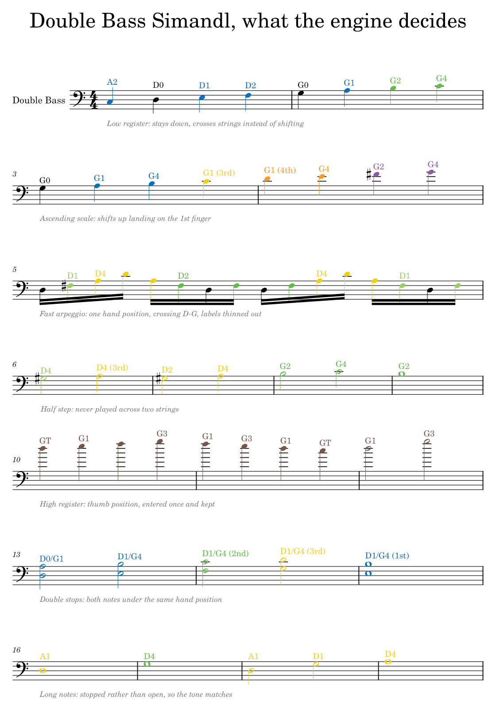

# 🎻 double-bass-fingering

> A MuseScore plugin that adds **Simandl fingerings** to double bass scores, using a cost model built from the standard pedagogical rules of bass fingering rather than "just prefer low positions".


---



## ✨ What it does

- Reads every note in the score (or selection), with its **duration** and the **rests around it**
- Works out every fingering the left hand could physically use, across all four strings, in neck positions **and thumb position**
- Picks the sequence with the lowest total cost by dynamic programming over the whole voice
- Writes **string + finger** labels (`A2`, `D4`, `E0`, `GT`) and colours each note by position
- Labels at reading density: every finger where the notes are long enough to carry a label, only the position changes in fast passages, and the position spelled out (`G1 (3ª)`) exactly where a shift would otherwise be invisible
- Handles **double stops**, skips **tied notes**, and replaces its own previous labels when you run it again

---

## 🎼 The rules it encodes

The cost function is not a generic "minimise movement" heuristic. Each term corresponds to a rule that bass teachers actually teach:

| | Rule | How it is priced |
|---|---|---|
| R1 | At least two notes per position | fixed cost for breaking position at all |
| R2 | **Never cross strings for a half step** | large penalty, larger still if one note is open |
| R3 | Fast passages: stay in position, cross strings | shift cost scales hard with tempo, crossing barely does |
| R4 | Melodic passages: shift along one string | crossing keeps a fixed timbre cost at any tempo |
| R5 | Don't cross strings on the same finger | penalty, worse going towards a lower string |
| R6 | No open strings in lyrical playing | penalty that grows with note length |
| R6b | Never two open strings in a row | penalty |
| R7 | Shift up with lower fingers (1-1-4) | penalty for landing on a high finger going up |
| R8 | Shift down with higher fingers (4-4-1) | mirror of R7 |
| R10 | Avoid crossing two strings at once | cost grows faster than linearly |
| R12 | Fingers 1-2 for lyrical notes | small penalty for 4th finger on long notes |
| R15 | Shift on a beat, not mid-gesture | small discount for shifting on a beat |

Where each of these comes from is listed under [Sources](#-sources).

Two more things the model knows:

- **Positions are not equally comfortable.** Half position is the most awkward spot on the instrument; 1st is home; the intermediate positions (2½, 3½ …) are playable but less idiomatic; above the heel the hand has to rotate. This lives in the `neckEase` table, one number per position, so you can tune it to your own hand.
- **Distance is measured in semitones**, not in position numbers. 1st → 2nd position is one semitone of travel and should be cheap; 2nd → 3rd is two. Numbering them 1, 2, 3 … gets this backwards.

---

## 🎨 Colour legend

| Colour | Position | | Colour | Position |
|---|---|---|---|---|
| ⚫ Black | Open string | | 🟠 Orange | 4th |
| 🩵 Cyan | Half | | 🔴 Red | 5th |
| 🔵 Blue | 1st | | 🟣 Purple | 6th |
| 🟢 Green | 2nd | | 🟤 Brown | Thumb position |
| 🟡 Yellow | 3rd | | ⚪ Grey | Out of range |

Intermediate positions (2½, 3½, 5½, 6½) get a lighter shade of the position below them.

---

## 📋 Requirements

- **MuseScore 4.4 or newer** (developed against 4.7.4)
- For **MuseScore 3.x / 4.0-4.3**: replace the `title` / `categoryCode` / `requiresScore` lines near the top of the `.qml` with
  `menuPath: "Plugins.Fingering.DoubleBassSimandl"`

---

## 📥 Installation

1. Download `DoubleBassSimandl.qml`
2. Copy it to your MuseScore plugins folder:

| OS | Path |
|----|------|
| Windows | `Documents\MuseScore4\Plugins\` |
| macOS | `~/Documents/MuseScore4/Plugins/` |
| Linux | `~/Documents/MuseScore4/Plugins/` |

3. **Restart MuseScore**
4. Go to `Home > Plugins` and enable **Double Bass Simandl**

---

## 🎼 Usage

1. Open a score with a double bass part
2. **Whole score:** select nothing. **One passage:** select it first
3. `Plugins > Composing/arranging tools > Double Bass Simandl`

Run it again after editing and it replaces its own labels instead of stacking new ones on top.

> ⚠️ The plugin reads **sounding** pitch, and double bass sounds an octave below what is written. On a properly configured double bass staff (the instrument carries an octave transposition) this is automatic. On a plain bass-clef staff with no transposition, every fingering will come out an octave off.

---

## 🛠 Customization

Everything lives in the `settings` block at the top of the `.qml`, and every weight is commented with the rule it implements. The ones worth touching first:

| Setting | Effect |
|---|---|
| `neckEase` | comfort of each position, one number per anchor fret. Lower = the solver likes it more |
| `useThumb` | set `false` to stay out of thumb position entirely |
| `thumbMinPitch` | how high a note has to be before thumb position is considered (default G3 sounding) |
| `useHalfPositions` | set `false` to forbid 2½, 3½, 5½, 6½ |
| `wShiftBase` / `wShift` | how expensive shifting is |
| `wCrossTone` / `wCrossBow` | how expensive crossing strings is (timbre / bow arm) |
| `colorNotes` | set `false` to leave note colours alone |
| `language` | `"en"` or `"es"`: position names print as `1st`/`TP` or `1ª`/`Pu` |
| `stringNaming` | `"auto"` (follows `language`), `"letters"` for `G1 D4`, or `"solfege"` for `Sol1 Re4` |
| `showPositionName` | set `true` to print the position on *every* stopped note, not just where a shift would go unnoticed |
| `labelEveryNote` | set `true` to label all notes, fast passages included |

---

## 🔬 Testing

The algorithm is a single pure function with no MuseScore API in it, marked off in the `.qml` by `// ===== CORE START/END =====`. The tools pull that exact code out of the plugin and run it under Node, so you can check a change without opening MuseScore:

```bash
python3 tools/make-demo-score.py demo.musicxml en   # the score in the screenshot
node tools/test-core.js     # 13 passages, with the expected reading of each
node tools/compare-old.js   # this version vs the previous one, side by side
python3 tools/qml-check.py DoubleBassSimandl.qml   # catches QML errors that stop
                                                   # the plugin from loading at all
```

You can also run the engine over a whole MusicXML file and look at the result as
a score, again without opening MuseScore:

```bash
python3 tools/apply-musicxml.py score.musicxml out.musicxml
mscore -r 130 -o out.png out.musicxml
```

`test-core.js` reports shifts and string crossings per passage, which is the quickest way to see whether a tweak to the weights helped or hurt.

---

## ⚠️ Limitations

- **Slurs are ignored.** The plugin API does not expose them reliably, so phrasing is inferred from note lengths and rests only.
- Chords of three or more notes are fingered from the **top note**; two-note chords are fingered as real double stops.
- No harmonics, and no alternative 1-2-3 hand shape in the upper neck.
- The result is a strong first draft, not a substitute for a teacher's eye.

---

## 📚 Sources

The weights are not invented. Every rule in the table above comes from published
pedagogy, and the ergonomics table comes from what teachers say about which
positions are actually comfortable.

| Source | What was taken from it |
|---|---|
| [Jason Heath, *What ARE the "rules" of double bass fingering?*](https://doublebassblog.org/2022/01/what-are-the-rules-of-double-bass-fingering.html) | The backbone: two notes per position, never cross strings for a half step, cross strings in fast passages but shift along one string in melodic ones, don't cross strings on the same finger, no open strings in lyrical playing, shift up with lower fingers and down with higher ones, avoid crossing two strings at once |
| [Double Bass HQ, same article](https://doublebasshq.com/learn_posts/what-are-the-rules-of-double-bass-fingering/) | Second copy of the rule list, plus the reminder that players break all of these all the time |
| [No Treble, *Fingering strategies for the upright bass*](https://www.notreble.com/buzz/2009/10/15/lesson-fingering-strategies-for-the-upright-bass/) | Economy of motion, no two open strings in a row, at least two notes per string in scale passages, fingers 1-2 preferred on lyrical notes (vibrato and fatigue), coordinating shifts with the beat, and the fast/slow trade-off (fast = fewer shifts and more open strings; slow = more shifts and fewer open strings) |
| [Double Bass HQ, *Rabbath vs Simandl*](https://doublebasshq.com/learn_posts/rabbath-vs-simandl-whats-the-best-double-bass-best-position-system/) and [BassBros on the Simandl technique](https://bassbros.co.uk/blog/the-simandl-technique-game-changer-or-thing-of-the-past/) | Half position is the hardest place on the instrument to play comfortably; the 1-2-4 hand keeps the left hand from overextending. This is why `neckEase` gives half position a worse score than 1st, 2nd or 3rd |
| [TalkBass, *Use of open strings*](https://www.talkbass.com/threads/use-of-open-strings.1126072/) | Open strings stick out in lyrical playing but are fine as passing notes; half steps across two strings sound odd, especially with an open string involved |
| [iDouble Bass, *A brief overview of thumb position*](https://idoublebass.com/thumb-position/) | Thumb position starts around written G on the third ledger line, which is the octave harmonic on the G string. This is `thumbMinPitch` |
| Franz Simandl, *New Method for the Double Bass* | The position system itself and the 1-2-4 fingering the plugin writes |

---

## 📄 License

[GPL-3.0](LICENSE), same license as MuseScore itself.
